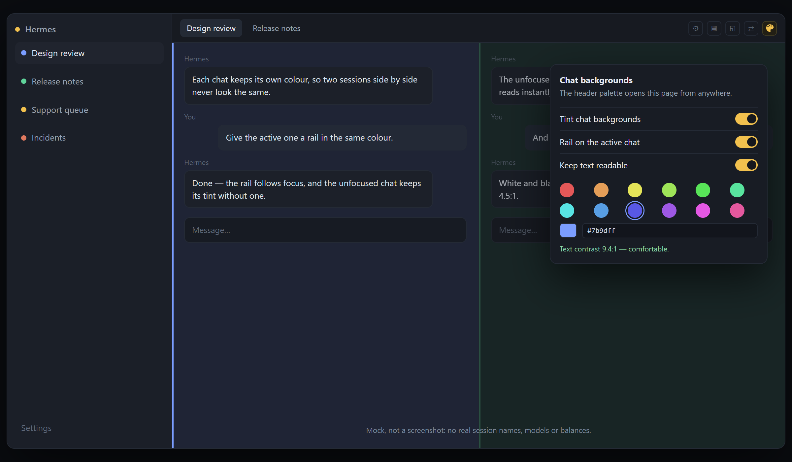
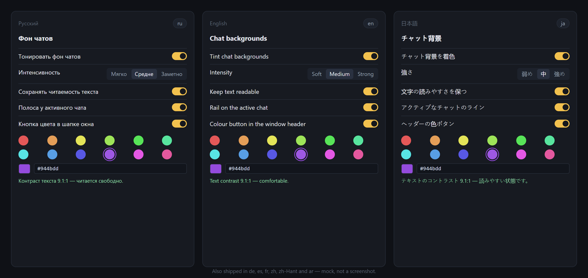

# Chat Backgrounds — per-chat colour for the Hermes desktop

Every chat wears **its own colour**, so two sessions side by side never look the same.
The chat you are working in gets a thin rail in that colour, and a measured contrast
guard keeps the text readable at any colour — white and black included.



## What it does

- **Per-chat tint.** Each chat surface is painted with the colour the session already
  has (the one behind its sidebar dot), washed into the theme background — `color-mix`
  against `--ui-bg-chrome`, so ink, borders and cards keep the theme palette.
- **Rail on the active chat.** A 2 px bar in the session colour, drawn only on the
  surface core marks as focused — pure CSS, no listener of yours.
- **Any colour.** The app's swatch grid, the system colour picker, or a typed hex.
  Everything goes through `host.sessions.setColor`, the same value the sidebar's colour
  menu writes, so a colour picked in either place is one value.
- **Colour changes land at once.** The app's own session menu may write on `pointerdown`
  and cancel the follow-up click, so the plugin defers the read to the next task instead of
  trusting an event phase: a pick repaints immediately, whichever menu wrote it.
- **Readable by construction.** For every painted surface the plugin measures the real
  contrast (resolved background against the theme ink) and thins the fill until the text
  passes WCAG AA (4.5:1). The measured number is shown under the picker.
- **Auto colour.** A chat with no colour of its own gets a stable hue derived from its
  id, so the feature works out of the box. Turn it off to tint only the chats you colour
  by hand.
- **Header button.** A palette icon in the window header opens this plugin's settings
  page; a switch hides it if you do not want it there.

## Install

Desktop plugin, no backend half:

```bash
git clone https://github.com/samieshmil-blip/hermes-chat-backgrounds
mkdir -p "$HERMES_HOME/desktop-plugins"
cp -r hermes-chat-backgrounds/desktop "$HERMES_HOME/desktop-plugins/chat-backgrounds"
```

On Windows that is `%LOCALAPPDATA%\hermes\desktop-plugins\chat-backgrounds\plugin.js`.
Then run **⌘K → Reload desktop plugins** (or restart the app).

Settings live in **Settings ▸ Plugins ▸ Chat backgrounds**, and the palette icon in the
window header goes straight there.

## Languages

Bundled in the app's own language list — the plugin follows the app locale, not the OS:

| | | | |
|---|---|---|---|
| English `en` | Русский `ru` | Deutsch `de` | Español `es` |
| Français `fr` | 日本語 `ja` | 中文 `zh` | 繁體中文 `zh-Hant` |
| العربية `ar` | | | |



## How it works

Core marks every chat surface with `data-chat-surface` and `data-session-anchor`
(`workspace` for the primary chat, `session-tile:<stored id>` for a session tile). A tile
therefore names its own session; the primary follows `host.state.focusedStoredSessionId`.
The plugin writes one CSS variable per surface and the stylesheet turns it into the wash:

```css
[data-chat-surface][data-hcb-tint] {
  --ui-chat-surface-background: color-mix(in srgb, var(--hcb-tint) 11%, var(--ui-bg-chrome));
}
```

No timers, no polling, no animation frames and no observers on the document tree: the
plugin repaints on app-owned signals (session focus, resize, visibility change, a
pointer/key interaction) and re-reads the colour map only when its raw value changed.

## Privacy

- No network calls, no telemetry, no analytics.
- Reads one desktop-local key, `hermes.desktop.sessionColors` — the per-session colours
  core itself persists — and only for this window's own profile. It also reads one key of
  its own, `hermes.plugin.chat-backgrounds.prefs`, for the switches.
- Writes only through the plugin SDK: `host.sessions.setColor` and `ctx.storage`.
- Does not patch the renderer: no prototype writes, no core module overrides, no
  `document.body` observers (the catalog's desktop lint refuses those, and the plugin is
  built to pass it).

## Limitations

- **Project colours are not tinted.** A chat that inherits its colour from a project shows
  that colour on the sidebar dot, but the background falls back to the auto hue or to the
  theme. The session→project map is not exposed to plugins.
- **Compressed sessions.** A colour set before a session id rotation stays keyed to the
  lineage root; the background follows the live id, so it can drop until the colour is set
  again.
- **Window translucency (glass).** The tint switches to an alpha mix so the window
  material still shows through, but this mode is the least tested one.
- **Late-mounting tiles.** A split tile that appears a frame after the focus change is
  painted by the deferred pass; it is never missed, but it is not observed as it mounts.
- **The dot beside a tab title is not the chat colour.** That circle is core's status
  indicator (working / unread / draft / idle), so it keeps its own vocabulary; the tint and
  the rail are the plugin's colour. When a chat is idle and has its own colour, the two
  match by construction.
- **The rule under the chat header keeps the theme colour.** The plugin colours the field
  and the rail, not core's hairline.

## Development

```bash
hermes plugins validate .   # catalog admission checks, incl. the desktop surface lint
hermes plugins doctor .     # runtime discovery, import and registration
```

`desktop/plugin.js` is plain ESM — no build step. The docs images are generated from
`docs/src/*.html` (open in a browser, capture at 2× ) and are mocks: no real session
names, models or balances appear in them.

## License

MIT — see [LICENSE](LICENSE).
